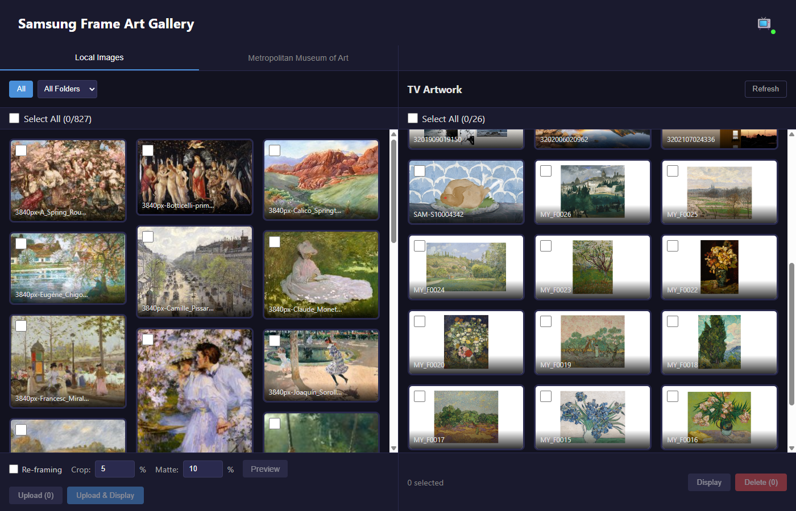
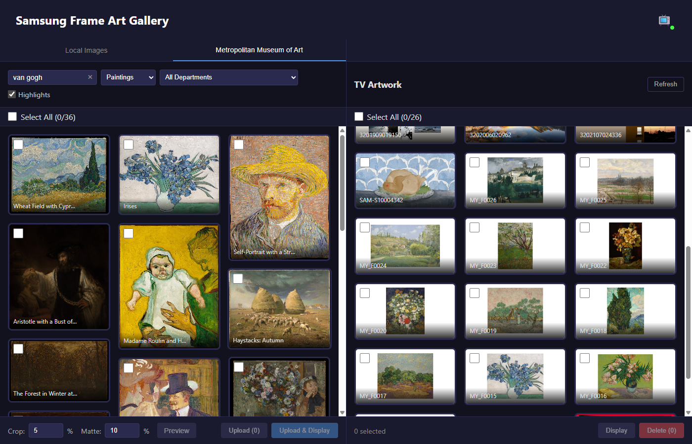
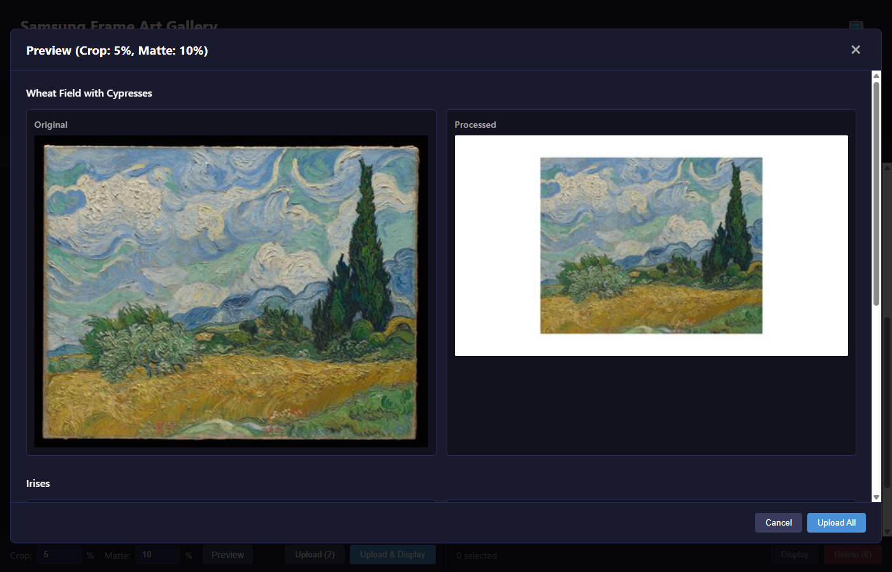
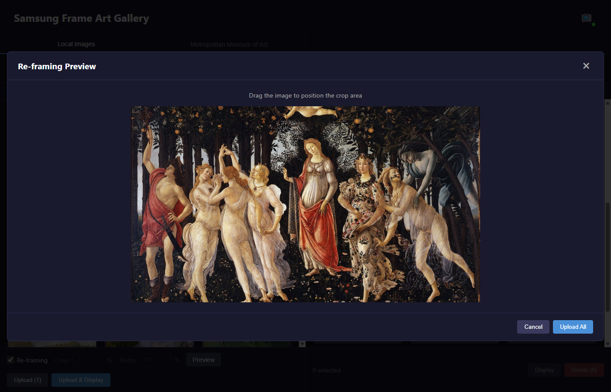

# Samsung Frame Art Gallery

A self-hosted web application for managing artwork on Samsung Frame TVs. Browse your local image collection or discover public domain masterpieces from the Metropolitan Museum of Art, then upload them to your TV with customizable framing options.


## Features

### Image Sources
- **Local Images** - Browse your personal image collection with folder navigation and smart thumbnails
- **Met Museum Collection** - Discover and upload public domain artwork from The Metropolitan Museum of Art's open collection (400,000+ works)

### TV Integration
- **Auto TV Discovery** - Automatically finds Samsung Frame TVs on your network via SSDP
- **Background Uploads** - Queue any number of images and keep browsing; a docked panel shows per-image progress, failed uploads retry automatically, and a Retry button covers the rest
- **Upload Tracking** - Local images already on the TV get an "ON TV" badge (and can be hidden), and TV artwork shows the file it came from
- **Sorting** - Sort local images and TV artwork newest or oldest first (local images also by name)
- **Labels & Label Slideshows** - Label TV artwork (e.g. "Nature"), filter by label, and run the slideshow on a single label
- **Art Management** - View, display, and delete artwork on your TV
- **Live Preview** - See exactly how your images will look before uploading

### Image Processing
- **Smart Cropping** - Remove unwanted edges from images (0-50%)
- **Auto Matte** - Automatically add museum-style matting to fit the 16:9 frame
- **Re-framing Mode** - Fill the entire frame with adjustable positioning for single images (on by default, so uploads have no white border)

### User Experience
- **Responsive Design** - Split-panel desktop layout, tabbed mobile interface
- **Infinite Scroll** - Seamless browsing through large collections
- **Masonry Layout** - Beautiful variable-height image grid
- **Docker-Ready** - Simple one-command deployment

## Screenshots

### Local Images with Masonry Layout
Browse your image collection with a beautiful masonry grid and TV artwork panel.



### Met Museum Collection Search
Search and browse public domain artwork from The Metropolitan Museum of Art.



### Preview with Crop & Matte
See how your images will look with cropping and automatic matting before upload.



### Re-framing Mode
Fill the entire frame with draggable positioning for single images.



## Quick Start

### Prerequisites

- Docker and Docker Compose
- Samsung Frame TV (or any Samsung TV with Art Mode) on the same network
- A folder of images (optional - you can also use the Met Museum collection)

### Installation

1. **Clone the repository**
   ```bash
   git clone https://github.com/yourusername/samsung-frame-art-gallery.git
   cd samsung-frame-art-gallery
   ```

2. **Configure your images path** (optional)

   Create a `.env` file or edit `docker-compose.yml`:
   ```bash
   # Option A: Using .env file
   echo "IMAGES_DIR=/path/to/your/images" > .env

   # Option B: Edit docker-compose.yml volumes directly
   ```

3. **Start the application**
   ```bash
   docker-compose up -d
   ```

4. **Open the web UI**

   Navigate to `http://localhost:8080`

5. **Connect to your TV**

   Click the TV status indicator in the header to discover and select your Samsung TV.

## Configuration

### Environment Variables

| Variable | Default | Description |
|----------|---------|-------------|
| `IMAGES_DIR` | `./images` | Path to your local image collection |
| `TV_IP` | - | Pre-configure TV IP (skips auto-discovery) |
| `DEFAULT_CROP_PERCENT` | `5` | Default edge crop percentage |
| `DEFAULT_MATTE_PERCENT` | `10` | Default matte size percentage |

### Docker Compose

```yaml
services:
  app:
    build:
      context: .
      dockerfile: docker/Dockerfile
    ports:
      - "8080:8080"
    volumes:
      - /path/to/your/images:/images:ro    # Your image collection
      - ./data/thumbnails:/thumbnails      # Thumbnail cache
      - ./data:/app/data                   # TV settings persistence
    environment:
      - TV_IP=${TV_IP:-}
      - DEFAULT_CROP_PERCENT=${DEFAULT_CROP_PERCENT:-5}
      - DEFAULT_MATTE_PERCENT=${DEFAULT_MATTE_PERCENT:-10}
    restart: unless-stopped
```

## Usage

### Local Images Tab

1. Browse your image collection using folder navigation; sort by newest, oldest or name
2. Select one or more images by clicking on them. Images already on the TV are marked "ON TV"; tick "Hide on TV" to show only what is left to upload
3. Re-framing (fill the frame, no border) is on by default; untick it to use crop and matte percentages instead
4. Click "Preview" to see how images will look on the TV
5. Click "Upload" or "Upload & Display". Uploads run in the background: the panel in the bottom-right corner shows each image, retries failures twice on its own, and offers Retry for anything that still fails

### Met Museum Tab

1. Browse highlighted works or filter by medium (Paintings, Drawings, etc.)
2. Use search to find specific artworks
3. Select works and preview/upload just like local images
4. All Met Museum images are public domain - free to use

### TV Panel

1. View all artwork currently stored on your TV, newest or oldest first
2. Artwork uploaded from this app is labelled with its source file name
3. Click any artwork to display it
4. Delete artwork you no longer want
5. Select artwork and click "Label" to add or remove labels; the chips above the grid filter by label
6. Turn on Slideshow and pick "All artwork" or a label, an interval (2 min to 1 hr) and shuffle

> **How label slideshows work:** the TV has no custom categories, so the app plays a label through the TV's **Favourites** list — it sets Favourites to exactly that label's artwork and runs the slideshow on Favourites. Favourites you set by hand on the TV are replaced while a label is playing.

### Artwork uploaded before upload tracking

Uploads are recorded in `data/uploads.json` from now on. To label artwork that was already on the TV, match it to your local files by thumbnail:

```bash
docker compose exec app python -m src.backfill_uploads          # show proposed matches
docker compose exec app python -m src.backfill_uploads --apply  # save them
```

Only near-identical matches are saved; artwork that did not come from your images folder is left alone.

## Getting 4K Artwork

Two optional scripts in `scripts/` download public-domain artwork from Wikimedia Commons into your images folder (`$IMAGES_DIR`, default `./images`), keeping only images large enough for a 3840x2160 screen and writing a `CREDITS.tsv` with licence and source for each file:

```bash
python3 scripts/fetch_art.py monet                # search, then pick which to download
python3 scripts/fetch_art.py "great wave" --all   # download every result
pip install Pillow && python3 scripts/fetch_framecrop_popular.py   # ~25 popular Frame artworks, cropped to fill 16:9
```

## Development

### Local Setup

**Backend:**
```bash
# Create virtual environment
python -m venv venv
source venv/bin/activate  # or `venv\Scripts\activate` on Windows

# Install dependencies
pip install -r requirements.txt

# Run with hot reload
uvicorn src.main:app --reload --host 0.0.0.0 --port 8080
```

**Frontend:**
```bash
cd src/frontend
npm install
npm run dev
```

### Project Structure

```
samsung-frame-art-gallery/
├── src/
│   ├── main.py                 # FastAPI application entry point
│   ├── backfill_uploads.py     # One-off: link existing TV artwork to local files
│   ├── api/
│   │   ├── images.py           # Local image endpoints
│   │   ├── tv.py               # TV control & upload endpoints
│   │   └── met.py              # Met Museum API endpoints
│   ├── services/
│   │   ├── tv_client.py        # Samsung TV WebSocket client
│   │   ├── tv_discovery.py     # SSDP-based TV discovery
│   │   ├── tv_settings.py      # Persistent TV selection
│   │   ├── met_client.py       # Met Museum API client
│   │   ├── image_processor.py  # Crop, matte, reframe processing
│   │   ├── thumbnails.py       # Local image thumbnails
│   │   ├── upload_registry.py  # Which local file each TV artwork came from
│   │   ├── labels.py           # Artwork labels and the label the slideshow plays
│   │   └── preview_cache.py    # Preview generation cache
│   └── frontend/               # Vue 3 + Vite SPA
│       ├── src/
│       │   ├── stores/
│       │   │   └── uploadQueue.js  # Background upload queue with retry
│       │   ├── views/
│       │   │   ├── LocalPanel.vue
│       │   │   ├── MetPanel.vue
│       │   │   └── TVPanel.vue
│       │   └── components/
│       └── package.json
├── scripts/                    # Optional 4K public-domain art downloaders
├── docker/
│   └── Dockerfile              # Multi-stage build
├── docker-compose.yml
└── requirements.txt
```

### Tech Stack

- **Backend:** FastAPI, Python 3.11+, Pillow, httpx
- **Frontend:** Vue 3.4, Vite 5
- **TV Communication:** [samsung-tv-ws-api](https://github.com/NickWaterton/samsung-tv-ws-api) (published on PyPI as `samsungframetv`)
- **External APIs:** [Met Museum Collection API](https://metmuseum.github.io/)
- **Infrastructure:** Docker, Docker Compose

## API Reference

### Local Images

| Method | Endpoint | Description |
|--------|----------|-------------|
| GET | `/api/images` | List images (optional `?folder=` filter) |
| GET | `/api/images/folders` | List available folders |
| GET | `/api/images/{path}/thumbnail` | Get image thumbnail |
| GET | `/api/images/{path}/full` | Get full image |

### Met Museum

| Method | Endpoint | Description |
|--------|----------|-------------|
| GET | `/api/met/departments` | List museum departments |
| GET | `/api/met/highlights` | Get highlighted artworks |
| GET | `/api/met/medium/{medium}` | Get artworks by medium |
| GET | `/api/met/search?q=` | Search artworks |
| GET | `/api/met/object/{id}` | Get artwork details |
| POST | `/api/met/preview` | Generate processed preview |
| POST | `/api/met/upload` | Upload artwork to TV |

### TV Control

| Method | Endpoint | Description |
|--------|----------|-------------|
| GET | `/api/tv/discover` | Scan for Samsung TVs |
| GET | `/api/tv/status` | Get TV connection status |
| GET | `/api/tv/settings` | Get saved TV selection |
| POST | `/api/tv/settings` | Save TV selection |
| GET | `/api/tv/artwork` | List artwork on TV (with `source_path` for artwork uploaded from this app) |
| GET | `/api/tv/artwork/current` | Get currently displayed artwork |
| POST | `/api/tv/artwork/current` | Display specific artwork |
| DELETE | `/api/tv/artwork/{id}` | Delete artwork from TV |
| POST | `/api/tv/preview` | Generate upload preview |
| POST | `/api/tv/upload` | Upload local images to TV |
| POST | `/api/tv/labels` | Add/remove labels on artwork (`content_ids`, `add`, `remove`) |
| GET | `/api/tv/slideshow` | Slideshow status, including the playing `label` |
| POST | `/api/tv/slideshow` | Set slideshow (`enabled`, `duration` in minutes, `shuffle`, optional `label`) |

## TV Compatibility

Tested with Samsung Frame TVs. Should work with any Samsung TV that supports Art Mode via WebSocket API.

**Supported TV API versions:**
- v3.x (older Frame models)
- v4.x+ (newer models with SSL)

## Troubleshooting

### TV not discovered

- Ensure your TV is on the same network/subnet as the host
- TV must be powered on (not in deep standby)
- Try manually entering the TV IP address in settings
- Check if your network blocks SSDP multicast (UDP 1900)

### Upload fails

- Verify the TV is in Art Mode (not regular TV mode)
- Check that image format is supported (JPEG, PNG)
- Ensure sufficient storage space on TV
- Large images may timeout - try with smaller files first

### Thumbnails not loading

- First load generates thumbnails - allow time for processing
- Check that images volume is mounted correctly
- Verify read permissions on the images directory

### Met Museum images not loading

- The Met API may be slow for large searches
- Some artworks don't have high-resolution images available
- Network connectivity to `collectionapi.metmuseum.org` required

## Contributing

Contributions are welcome! Please feel free to submit a Pull Request.

1. Fork the repository
2. Create your feature branch (`git checkout -b feature/amazing-feature`)
3. Commit your changes (`git commit -m 'Add amazing feature'`)
4. Push to the branch (`git push origin feature/amazing-feature`)
5. Open a Pull Request

## License

This project is licensed under the MIT License - see the [LICENSE](LICENSE) file for details.

## Acknowledgments

- [samsung-tv-ws-api](https://github.com/NickWaterton/samsung-tv-ws-api) - Samsung TV WebSocket API library
- [The Metropolitan Museum of Art Collection API](https://metmuseum.github.io/) - Public domain artwork access
- Samsung for creating the Frame TV with Art Mode
